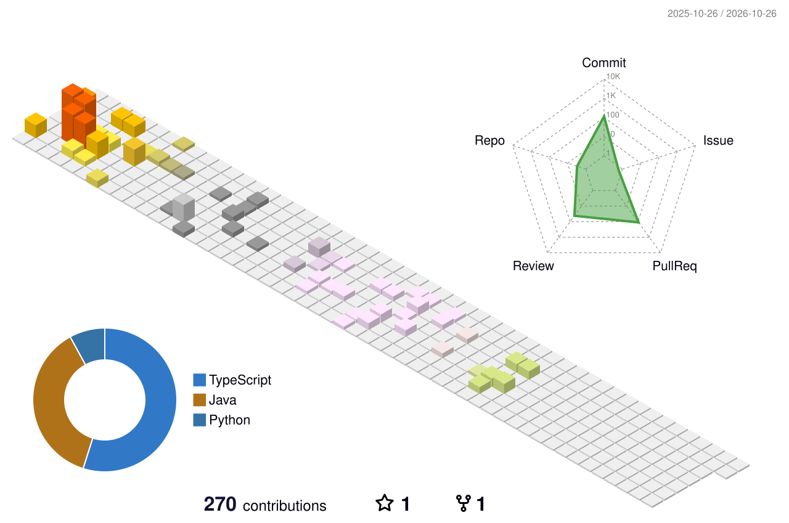

# 이서준 (Seojun Lee)

**Backend Developer | Open to Opportunities**

- Email: [tmddnr3503@gmail.com](mailto:tmddnr3503@gmail.com)
- Blog: [tmddnr3503.tistory.com](https://tmddnr3503.tistory.com/)

---

## Core Competencies

- **Backend · Application:** Spring Boot 기반 REST API 개발, 도메인 중심 설계, MyBatis/JPA 기반 데이터 접근
- **Architecture:** MSA 설계 (Spring Cloud Gateway, 서비스 분리, CommonModule 공통 모듈화)
- **Databases:** Oracle/MySQL 스키마 설계, MongoDB Document 모델링, Redis 캐싱 전략 설계
- **Performance:** k6/JMeter 부하 테스트, BCrypt 튜닝, Token 병렬 생성, DB 인덱싱, Redis 캐싱을 통한 응답시간 최적화
- **Integration:** ESB 기간계 전문 통신, 외부 API 연동 (Clova OCR, OpenAI, Eternal Return API)
- **Infra · DevOps:** Docker, GitHub Actions, AWS (EC2, S3)

---

## Experience

### Backend Developer — InsurTech (블랙박스 영상활용 AI 과실판정 시스템)

_2026 – Present · On-site, South Korea_

- 블랙박스 영상 기반 AI 과실비율 판정 시스템의 관리자 WAS 및 영상 수신 WAS 백엔드 개발을 담당.
- ESB를 통한 기간계 시스템과의 전문 통신 인터페이스 개발.
- Oracle Database 기반 다중 스키마(BIDADM · BIUADM · BIUINF) 환경에서 MyBatis 매퍼 기반 데이터 접근 계층 구축.
- AI 분석 정확도 집계 API 개발.
- **Stack:** Spring Boot 2.7, Java 8, Oracle Database, MyBatis, Spring Security, SSO (WiseAccess), WebFlux, H2 Database

---

## Personal Projects

### CureBridge — 건강 관리 통합 플랫폼 · 2025 – 2026

MSA 구조의 건강 관리 통합 플랫폼. MSA 아키텍처 설계 및 ContentService 핵심 기능 개발 담당.

- MSA 4개 서비스 설계 (Gateway · MemberService · ContentService · Chat) 및 CommonModule 공통 라이브러리 구축.
- Clova OCR → 정규식 파싱 → MongoDB 저장 파이프라인과 OpenAI 기반 월간 AI 건강 레포트 자동 생성 시스템 개발.
- Redis 캐싱 직렬화 이슈를 3주에에 걸쳐 근본 해결 (JavaTimeModule + DefaultTyping + Wrapper DTO).
- k6 부하 테스트 기반 로그인 성능 50~60% 개선 (BCrypt 튜닝 · Token 병렬 생성 · DB 인덱싱 · HikariCP 튜닝).
- Docker 타임존 불일치 해결 (OS tzdata + JVM TimeZone 이중 방어).
- MSA 간 JWT 알고리즘 불일치 → CommonModule 기반 전 서비스 키/알고리즘 통일.
- **Stack:** Spring Boot, Spring Cloud Gateway, Spring Security, MySQL (JPA), MongoDB, Redis, Docker, AWS, k6, JMeter, Clova OCR, OpenAI

### EternalReturnGG — 게임 데이터 분석 서비스 · 2026

Eternal Return API 연동 유저 전적 분석 서비스. MongoDB 집계와 MySQL 연동으로 캐릭터 통계 구현.

- MongoDB Aggregation Pipeline으로 유저별 Top 7 캐릭터 집계 → MySQL 저장.
- API 응답 필드 불일치(89→64 캐릭터 누락) 원인 분석 및 해결: 누락 필드 15개 매핑 + `@JsonIgnoreProperties` 적용.
- **Stack:** Spring Boot, MongoDB, MySQL, Jackson

---

## Tech Stack

### Backend & Application

### Databases

### Integration & Middleware

### Infra & DevOps

### Testing & Monitoring

---

## Stats

## Blog Posts
<!-- BLOG-POST-LIST:START -->
- [CS&rpar; OOAD와 UML 개발 방식](https://tmddnr3503.tistory.com/111)
- [CS&rpar; CASE, 럼바우 기법, 요구사항 모델링](https://tmddnr3503.tistory.com/102)
- [CS&rpar; 객체지향 설계 원칙과 OOAD](https://tmddnr3503.tistory.com/101)
- [CS&rpar; 응집도 &lpar; Cohesion &rpar;](https://tmddnr3503.tistory.com/100)
<!-- BLOG-POST-LIST:END -->
